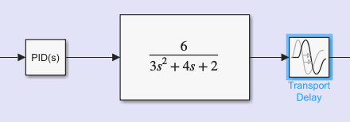
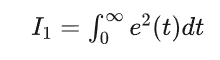
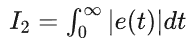
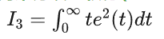
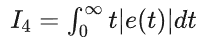
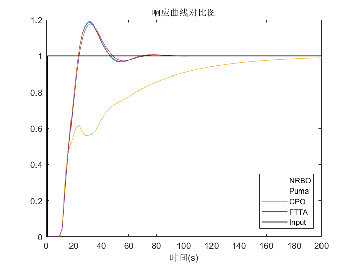
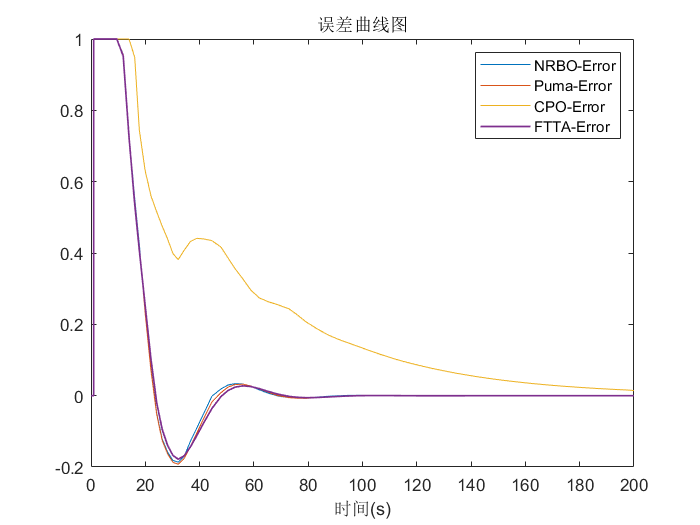
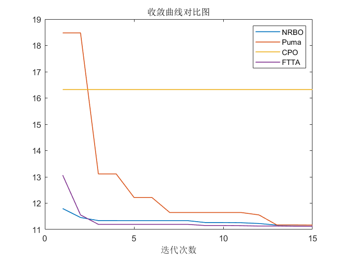
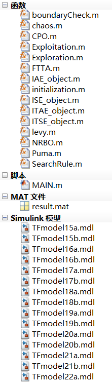

# 2024 intelligent algorithm optimization of PID parameters, four adaptive functions (ITAE, ISE, ITSE, IAE) can be switched at will, with MATLAB code attached.

The tuning of PID parameters is the process of determining the proportional (Kp), integral (Ki), and derivative (Kd) coefficients to ensure that the PID controller can achieve stable, fast, and accurate responses in the system.
The theme for this issue.
Four intelligent optimization algorithms for 2024 are used to optimize the three parameters of PID, in order to achieve a better response curve.
The four algorithms are: Newton-Raphson optimization algorithm, Lion Optimization Algorithm, Football Training Algorithm, and Crowned Pig Optimization Algorithm. All four algorithms are the latest optimization algorithms in 2024.
Specific principles
Firstly, build a specific model using Simulink, which is simple and easy to modify!
Simply open the Simulink model, and modify the function here. The delay section can also be freely modified within it!
Subsequently, within the main function, the model is continuously called, and optimization is performed using four commonly used evaluation metrics for PID parameters (ITAE/ISE/ITSE/IAE) as fitness function indicators.
The four fitness function formulas are as follows:
Square Error Integral (ISE):
\n        \n  
Absolute Error Integral (IAE):
\n        \n  
Time-squared error integral (ITSE):
\n        \n  
Time-multiplied absolute error integral (ITAE):
\n        \n  
The code has been integrated, convenient for modifying the fitness function:
xz = 1; % Four adaptive objective functions available: Squared Error Integral / Time multiplied by Absolute Error Integral / Time squared Error Integral / Absolute Error Integral
Response curve comparison chart:
It can be observed that the CPO algorithm has the worst optimization effect, while the other three have comparable optimization effects.
Error Curve Graph:
Convergence curve graphs of four algorithms:
Finally, the optimal PID parameters are obtained by four algorithms.
NRBO  
PumaCPOFTTA  
Kp  
0.087410.0751920.128410.07292  Ti  
3.5447 3  15.27193    Td0.10708 5.4380.169823.9195  
The code directory is as follows:
Considering that the versions of MATLAB may vary among everyone, the author here saves different versions of Simulink models.
Select the appropriate version model, and replace TFmodel22 in the main function and four fitness function files with the corresponding version of TFmodelXX to enable the program to run!

## Images

<!-- PAYMENT_BLOCK -->

## Get this dataset

- Payment link (Stripe): [Buy now](https://buy.stripe.com/3cs8yP7sY87d0vu9AB)
- Payment QR code: 

<!-- /PAYMENT_BLOCK -->
